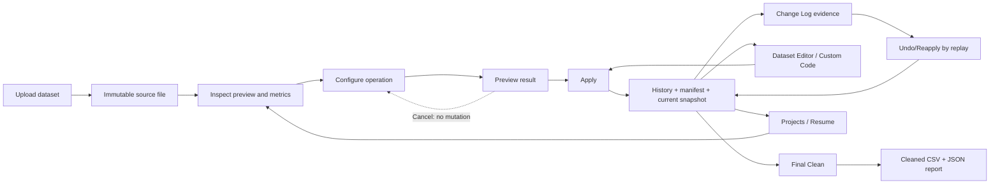
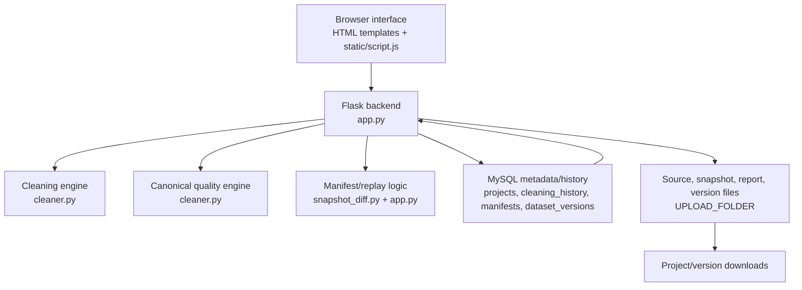

# inDataOut

inDataOut is a local-first data-cleaning application. It accepts structured datasets, previews cleaning operations, applies approved changes to a server-side current dataset, records Before/After evidence, supports Undo/Reapply, calculates data-quality metrics, and exports cleaned results.

## What the Application Does

The app keeps the uploaded source file unchanged for the life of a project. Preview builds a temporary result. Apply commits an approved operation to the server-side current dataset and records one Change Log entry with operation metadata and Before/After evidence.

The same current dataset is used for the editor, Change Log refreshes, Final Clean, CSV downloads, JSON reports, project versions, and Resume.

## Supported Input

Supported extensions are defined in `app.py`:

- `.csv`
- `.tsv`
- `.txt`
- `.xlsx`
- `.xls`
- `.json`

The Flask upload limit is `100 MB` through `MAX_CONTENT_LENGTH`. Large files can still be slow or memory-heavy because several routes materialize full DataFrames.

## User Workflow

1. Upload a dataset.
2. Inspect the initial preview, column summary, missing values, duplicate count, and quality metrics.
3. Choose a cleaning operation.
4. Configure the operation.
5. Preview the proposed result.
6. Apply the operation or cancel it.
7. Inspect the Change Log entry and its Before/After evidence.
8. Undo or reapply actions when needed.
9. Use Dataset Editor or trusted custom code for manual changes.
10. Final Clean the current version.
11. Download the cleaned CSV and JSON report.
12. Open Projects to view, download, delete, or Resume saved projects.



## Cleaning Operations

### Whitespace Trimming

The user selects trimming for text fields. The operation strips actual string values and leaves numbers, booleans, timestamps, objects, and nulls unchanged. Preview shows changed cells. Apply records old and new values.

### Placeholder Replacement

The user explicitly enables placeholder replacement and supplies or accepts placeholder tokens. Matching values are converted to missing values. Preview shows counts and examples. Apply records replacement cells and metadata.

### Missing Values

The user chooses numeric and categorical strategies, selected columns, constants, or row dropping. The operation fills missing cells or removes rows according to the selected strategy. Preview shows affected rows/cells. Apply records fill values, affected rows, and row removals.

### Duplicate Removal

The user can remove exact duplicate rows or duplicates based on selected subset keys. Preview shows retained shape and removed rows. Apply records duplicate criteria and removed-row evidence.

### Column Removal

The user can remove empty columns, constant columns, or selected columns. Preview shows before and after columns. Apply records removed columns and affected shape.

### Column Rename and Normalization

The user can rename columns or use normalization paths exposed by the UI. The operation validates resulting column names and rejects conflicting results where implemented. Preview shows old and new names. Apply records rename mappings.

### Data Type Conversion

The user selects target dtypes such as numeric, integer, float, datetime, string, category, or boolean. Conversion metadata records requested dtype, resulting dtype, coercion count, rounding count where relevant, and failures. Preview and Apply use that metadata.

### Outliers

The user detects IQR outlier candidates, reviews rows, and selects removal or clipping options where available. Preview shows row identity, displayed row number, column, value, and bounds. Apply records selected rows or clipped cells.

### Label Encoding

The user enables categorical encoding. Missing values remain missing unless a missing category is explicitly selected. Preview shows encoded columns and mappings. Apply records deterministic category-to-integer mappings.

### Dataset Editor

The user edits cells in the Dataset Editor. Saved edits go through the server Apply path. Apply records old and new cell values.

### Custom Code

The user runs trusted local Pandas code. Preview shows output blocks and observed changes such as modified cells, added/removed rows, and added/removed columns. Apply records the code label, operation order, and observed structural/value changes.

## Preview and Apply

Preview does not mutate the authoritative dataset. It returns a proposed result, metrics, preview rows, and operation metadata.

Apply commits the operation through the backend. A successful Apply creates or updates:

- the current server-side snapshot,
- one persisted Change Log history row,
- a manifest for replay and Before/After evidence,
- quality metrics calculated from the committed DataFrame.

If an operation makes no changes, the app avoids creating a misleading transformation entry unless the route intentionally records a no-op. Stale or invalid mutation requests are rejected where dataset-version checks are available.

## Change Log

The Change Log is rendered from server-provided history and operation metadata. A card can include:

- action type and status,
- Before/After shape,
- affected rows, cells, or columns,
- changed-cell old/new values,
- removed or added rows,
- removed or added columns,
- rename mappings,
- dtype or encoding metadata,
- bounded previews when the full change list is too large.

History status is persisted as `applied` or `undone`. Browser-rendered table data is not used as the source of truth for committed history.

## Undo and Reapply

Undo and Reapply rebuild from the immutable source and replay active actions in their original commit order. This preserves later overlapping actions. The app does not rely on direct browser-side reversal or a simple reverse patch as the authoritative result.

Reapplying an older action restores it to its original ordered position and then replays the active action list.

## Dataset Editor

The Dataset Editor shows a page or preview of the current dataset and supports manual cell edits. Saved edits are sent to the backend and committed like other actions. The server returns the updated row mapping, columns, preview data, and history entry.

Paging exists for editor reads through `/api/editor-page`, but not every preview/export path is chunked. Very large datasets can still take longer to render or process.

## Custom Code

Custom code is restricted to trusted local use. It runs exactly as written against a DataFrame copy and may modify, filter, replace, add, or remove data. The app reports observed changes, but arbitrary code cannot always receive the same semantic explanation as built-in operations.

Set `INDATAOUT_TRUSTED_LOCAL=0` before exposing the app beyond the local machine.

## Data-Quality Score

The score is a heuristic. It is calculated from the authoritative DataFrame, does not modify data, and is not a guarantee that the dataset is correct. A valid cleaning operation is not guaranteed to increase the score.

`data_quality_score()` and `data_quality_breakdown()` use the same canonical calculation in `cleaner.py`.

The score starts at 100 and subtracts weighted component percentages:

| Component | Weight | Formula Summary |
| --- | ---: | --- |
| Completeness | 0.25 | missing cells / total cells |
| Duplicate-row rate | 0.15 | duplicate rows / total rows |
| Placeholder rate | 0.15 | placeholder string cells / total cells |
| Type-conformance issues | 0.15 | numeric-looking invalid values / checked values |
| IQR outlier flag rate | 0.10 | IQR-flagged cells / numeric cells |
| Constant-column observation | 0.05 | constant columns / total columns |
| Row retention | 0.10 | rows removed compared with original |
| Column retention | 0.05 | columns removed compared with original |

Nulls are not double-counted as placeholder strings. Row and column retention use the immutable original when it is available.

## Final Clean and Downloads

Final Clean uses the current authoritative DataFrame. It writes:

- a versioned cleaned CSV, for example `cleaned_<source>_v0001_<timestamp>.csv`,
- a JSON report for the same finalized DataFrame,
- a dataset-version record for the project.

The CSV is written through a temporary file and validated by reading it back before the route presents the result. CSV export does not preserve Excel formatting, formulas, workbook sheets, or original JSON structure.

## Projects and Resume

Each upload creates a project with its own source file, history, manifests, snapshots, reports, and versions. Opening a project detail page shows project metadata, action history, and dataset versions.

Resume restores the project into the active session and rebuilds the current dataset from the immutable source plus active ordered actions. If the original source file is missing, the project is treated as damaged instead of silently treating a cleaned file as the new source.

Project and version downloads are scoped by project/version identity.

## System Architecture



## Data Lifecycle

```text
Upload
  -> immutable source file
  -> preview result
  -> committed action
  -> current snapshot + history row + manifest
  -> replay from source and active history
  -> Final Clean
  -> versioned CSV + JSON report
```

## Correctness and Safety Behavior

- Uploaded source files are preserved for project replay.
- Preview does not commit data.
- Apply is server-authoritative.
- Change Log evidence comes from persisted history/manifest data.
- No-op actions do not get described as successful transformations.
- Undo/Reapply rebuilds from source and active ordered actions.
- CSRF validation is applied to state-changing routes.
- Download paths are validated and project scoped.
- Custom code is trusted-local only.
- Score and breakdown come from the same canonical calculation.

## Application Outputs

Users receive:

- dataset previews,
- Before/After evidence,
- Change Log history,
- quality score and breakdown,
- cleaned CSV files,
- JSON cleaning reports,
- saved project records,
- immutable dataset-version records.

## Tests

Python compilation:

```powershell
.\.venv\Scripts\python.exe -B -m py_compile app.py db.py cleaner.py snapshot_diff.py custom_code_runner.py setup_database.py desktop_launcher.py smoke_correctness_workflow.py tests\test_correctness_core.py tests\test_app_safety_systems.py tests\test_quality_canonical.py
```

Unit and integration tests:

```powershell
.\.venv\Scripts\python.exe -m unittest tests.test_correctness_core tests.test_app_safety_systems tests.test_quality_canonical
```

JavaScript syntax check:

```bash
node --check static/script.js
```

The tests cover core cleaning regressions, manifest/replay behavior, app safety routes, canonical quality scoring, CSRF error shape, paging responses, idempotent Apply behavior, and output/report consistency checks present in the current test files. They do not replace a full rendered browser workflow.

## Known Limitations

- The app is local-first and does not include multi-user authentication.
- Custom code executes trusted local Python.
- Dependency versions are not pinned in `requirements.txt`.
- Some preview/export paths still materialize full DataFrames.
- Dataset Editor paging is not wired into every workflow surface.
- CSV export can change representation for some dtypes, leading-zero identifiers, or very large IDs unless handled carefully before/after export.
- Diagnostics and progress feedback exist, but there is not a complete durable background-job system for every long-running operation.
- Browser automation is not documented as passing unless it is run separately in the current environment.

## Related Setup Documentation

See [SETUP.md](SETUP.md) for installation, configuration, database initialization, run commands, storage locations, logs, troubleshooting, and cleanup.
